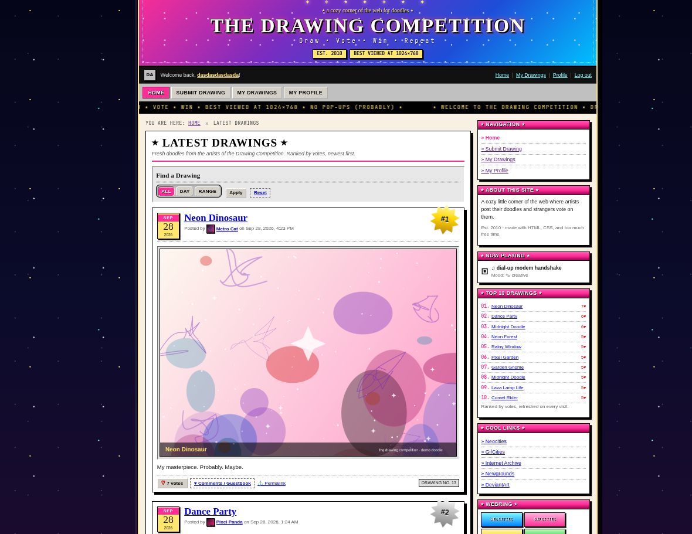
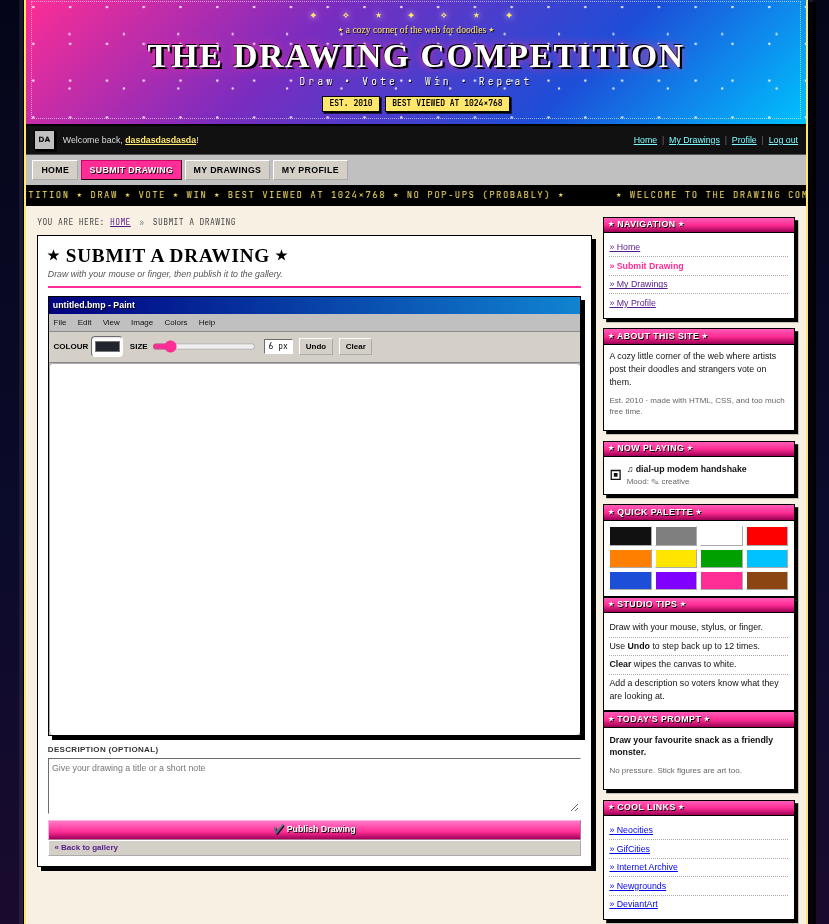
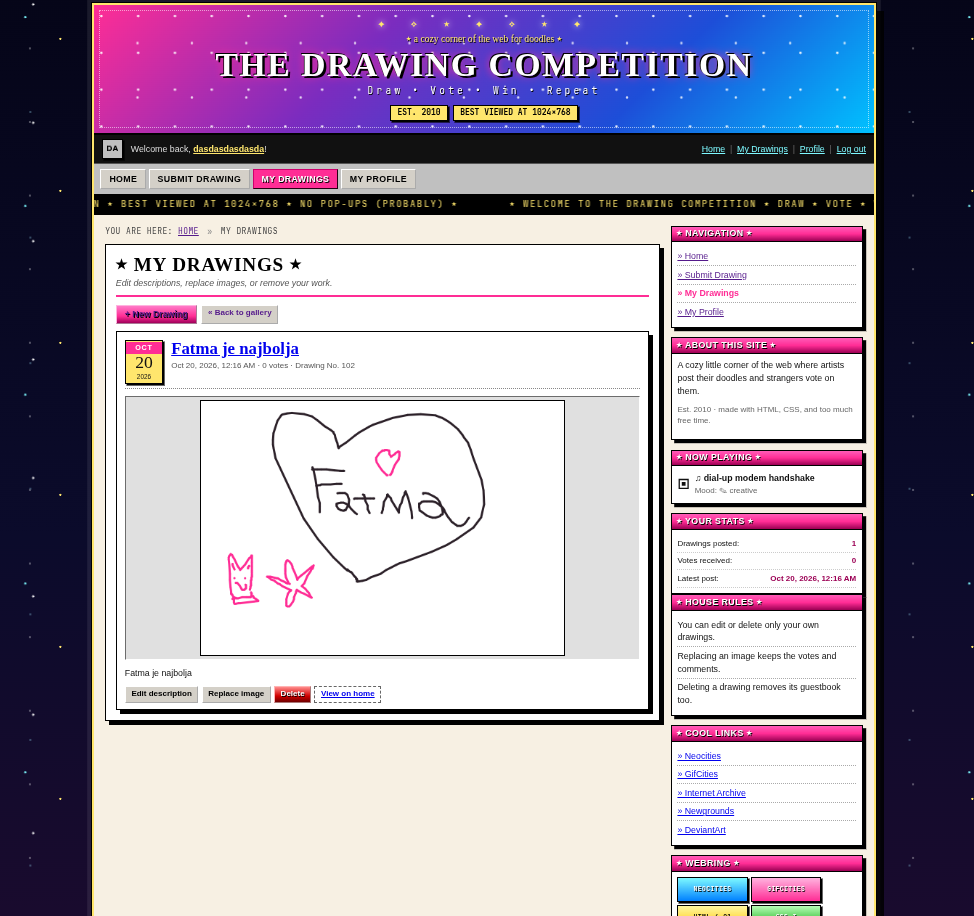
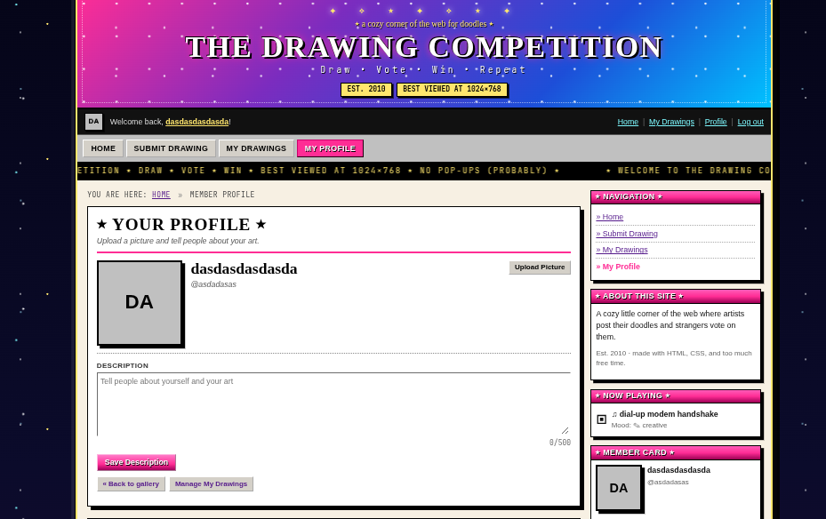

# 🎨 The Drawing Competition

> A retro-styled drawing competition web app built with **Spring Boot 4**, **PostgreSQL**, and vanilla **ES Modules** — featuring a full GeoCities/Neocities "webcore" aesthetic.

[](https://openjdk.org/)
[](https://spring.io/projects/spring-boot)
[](https://www.postgresql.org/)
[](https://gradle.org/)
[](LICENSE)

---

## ✨ Live Preview

| Page | Screenshot |
|------|------------|
| **Home Feed** — Blog-style ranked drawings with date badges, vote counts, and Top 10 sidebar |  |
| **Drawing Viewer** — Windows 95-style modal dialog with comments/guestbook |  |
| **My Drawings** — Manage your gallery: edit descriptions, replace images, delete |  |
| **Profile** — Avatar upload, bio, member card widget, latest drawings |  |

---

## 🎯 Project Highlights

- **Full GeoCities/Neocities "webcore" theme** — tiled starfield background, animated banner, `<marquee>`, beveled buttons, 88×31 badges, MS Paint–style drawing studio, Windows 95–style dialogs
- **Blog-style ranked feed** — date badges (month/day/year), rank starbursts (#1 gold, #2 silver, #3 bronze), "NEW!" blinkies, vote/comment/permalink actions
- **Canvas drawing studio** — 1000×700 px canvas, colour picker, brush size, undo (12 steps), clear, quick palette sidebar, daily prompt widget
- **Authentication** — session-based login/register with BCrypt, CSRF protection via cookie token
- **Pagination** — 20 items/page on home feed and my-drawings, retro-styled page navigator
- **Voting & Comments** — one vote per user per drawing, guestbook-style threaded comments with edit/delete
- **Profile system** — avatar upload (2 MB max, PNG/JPEG/WebP), display name, bio (500 chars), member card widget
- **Date filtering** — view drawings by single day or custom date range (UTC)
- **Owner-only actions** — edit/replace/delete only your own drawings
- **100% vanilla ES Modules frontend** — no build step, no framework, no bundler
- **Idempotent demo seeder** — `app.seed-demo-data=true` creates 10 users + 100 procedural PNG drawings with votes/comments

---

## 🏗 Architecture

```
┌─────────────────────────────────────────────────────────────────┐
│                        Browser (ES Modules)                     │
│  home.js │ my-drawings.js │ profile.js │ newdrawing.js │ auth.js│
│  shell.js (header, sidebar, footer, marquee, widget API)        │
│  api.js  (CSRF-aware fetch wrapper, date formatting, avatars)   │
└──────────────────────────┬──────────────────────────────────────┘
                           │ HTTP/JSON + Multipart
                           ▼
┌─────────────────────────────────────────────────────────────────┐
│                     Spring Boot 4.1.1 (Java 21)                 │
│  ┌─────────────┐ ┌─────────────┐ ┌─────────────┐ ┌───────────┐ │
│  │ DrawingController │ │ ProfileController │ │ AuthController │ │
│  │ VoteController    │ │ CommentController │ │ PageController │ │
│  └─────────────┘ └─────────────┘ └─────────────┘ └───────────┘ │
│                           │                                      │
│  ┌─────────────────────────────────────────────────────────────┐ │
│  │ Services (Drawing, Profile, Vote, Comment, Auth)            │ │
│  └─────────────────────────────────────────────────────────────┘ │
│                           │                                      │
│  ┌─────────────────────────────────────────────────────────────┐ │
│  │ Spring Data JPA Repositories (Drawing, User, Vote, Comment) │ │
│  └─────────────────────────────────────────────────────────────┘ │
└──────────────────────────┬──────────────────────────────────────┘
                           │ JDBC
                           ▼
┌─────────────────────────────────────────────────────────────────┐
│                    PostgreSQL 17 (UTC timezone)                 │
│  users │ drawings │ votes │ comments (FK + unique constraints)  │
└─────────────────────────────────────────────────────────────────┘
```

---

## 🛠 Tech Stack

| Layer | Technology | Version |
|-------|------------|---------|
| **Language** | Java | 21 (LTS) |
| **Framework** | Spring Boot | 4.1.1 |
| **Security** | Spring Security | 7.1.1 (session + CSRF cookie) |
| **Data** | Spring Data JPA + Hibernate | 7.4.5 |
| **Database** | PostgreSQL | 17 |
| **Migration** | Flyway | 12.4.0 |
| **Build** | Gradle | 9.8 (Kotlin DSL) |
| **Frontend** | Vanilla ES Modules (no build) | — |
| **Styling** | CSS Custom Properties + GeoCities theme | — |
| **Canvas** | Canvas 2D API | — |
| **Testing** | JUnit 5 + Testcontainers + MockMvc | — |

---

## 🗄 Database Schema

```sql
-- Users
CREATE TABLE users (
    id              BIGSERIAL PRIMARY KEY,
    username        VARCHAR(30)  NOT NULL UNIQUE,
    display_name    VARCHAR(50)  NOT NULL,
    password_hash   VARCHAR(100) NOT NULL,
    created_at      TIMESTAMPTZ  NOT NULL DEFAULT now(),
    bio             TEXT,
    avatar_data     BYTEA,
    avatar_content_type VARCHAR(100),
    has_avatar      BOOLEAN      NOT NULL DEFAULT false
);

-- Drawings (image stored as BYTEA)
CREATE TABLE drawings (
    id              BIGSERIAL PRIMARY KEY,
    user_id         BIGINT       NOT NULL REFERENCES users(id) ON DELETE CASCADE,
    description     TEXT,
    image_data      BYTEA        NOT NULL,
    content_type    VARCHAR(100) NOT NULL,
    created_at      TIMESTAMPTZ  NOT NULL DEFAULT now(),
    updated_at      TIMESTAMPTZ  NOT NULL DEFAULT now()
);
CREATE INDEX idx_drawings_created_at ON drawings (created_at);
CREATE INDEX idx_drawings_user_id   ON drawings (user_id);

-- Votes (one per user per drawing)
CREATE TABLE votes (
    id              BIGSERIAL PRIMARY KEY,
    drawing_id      BIGINT      NOT NULL REFERENCES drawings(id) ON DELETE CASCADE,
    user_id         BIGINT      NOT NULL REFERENCES users(id) ON DELETE CASCADE,
    created_at      TIMESTAMPTZ NOT NULL DEFAULT now(),
    CONSTRAINT uq_votes_drawing_user UNIQUE (drawing_id, user_id)
);
CREATE INDEX idx_votes_drawing_id ON votes (drawing_id);
CREATE INDEX idx_votes_user_id    ON votes (user_id);

-- Comments (guestbook)
CREATE TABLE comments (
    id              BIGSERIAL PRIMARY KEY,
    drawing_id      BIGINT      NOT NULL REFERENCES drawings(id) ON DELETE CASCADE,
    user_id         BIGINT      NOT NULL REFERENCES users(id) ON DELETE CASCADE,
    body            TEXT        NOT NULL,
    created_at      TIMESTAMPTZ NOT NULL DEFAULT now(),
    updated_at      TIMESTAMPTZ NOT NULL DEFAULT now()
);
CREATE INDEX idx_comments_drawing_id ON comments (drawing_id);
CREATE INDEX idx_comments_user_id    ON comments (user_id);
```

---

## 🔌 API Endpoints

All endpoints under `/api` require authentication (session cookie). CSRF token via `XSRF-TOKEN` cookie → `X-XSRF-TOKEN` header for mutating requests.

### Authentication
| Method | Endpoint | Description |
|--------|----------|-------------|
| `POST` | `/api/auth/register` | Register new account `{username, displayName, password}` |
| `POST` | `/api/auth/login` | Login `{username, password}` → sets session cookie |
| `POST` | `/api/auth/logout` | Invalidate session |
| `GET`  | `/api/auth/me` | Current user profile |
| `GET`  | `/api/auth/csrf` | CSRF token `{headerName, token, cookieName}` |

### Drawings
| Method | Endpoint | Description |
|--------|----------|-------------|
| `POST` | `/api/drawings` | Create drawing (multipart: `image` + optional `description`) |
| `GET`  | `/api/drawings` | List drawings (paginated, ranked by votes desc, newest first) |
| `GET`  | `/api/drawings/mine` | Current user's drawings (newest first) |
| `GET`  | `/api/drawings/{id}` | Single drawing with vote info |
| `GET`  | `/api/drawings/{id}/image` | Raw image bytes (`image/png`, `image/jpeg`, `image/webp`) |
| `PATCH`| `/api/drawings/{id}` | Update description (owner only) |
| `PUT`  | `/api/drawings/{id}/image` | Replace image (owner only) |
| `DELETE`| `/api/drawings/{id}` | Delete drawing + votes + comments (owner only) |

**Query params for `/api/drawings` and `/api/drawings/mine`:**
```
page=0          # zero-based page index (default 0)
size=20         # page size (default 20)
date=2026-10-19 # single day filter (UTC)
from=2026-10-01 # range start (inclusive, UTC)
to=2026-10-19   # range end (inclusive, UTC)
```

**Response format (Page):**
```json
{
  "content": [ { "id": 1, "description": "...", "createdAt": "...", "owner": {...}, "voteCount": 5, "votedByMe": false, "imageUrl": "/api/drawings/1/image" } ],
  "pageable": { "pageNumber": 0, "pageSize": 20, "sort": {...} },
  "totalElements": 100,
  "totalPages": 5,
  "number": 0,
  "size": 20,
  "first": true,
  "last": false,
  "empty": false
}
```

### Votes
| Method | Endpoint | Description |
|--------|----------|-------------|
| `POST`   | `/api/drawings/{drawingId}/votes` | Vote (returns updated drawing) |
| `DELETE` | `/api/drawings/{drawingId}/votes` | Remove vote |

### Comments
| Method | Endpoint | Description |
|--------|----------|-------------|
| `GET`    | `/api/drawings/{drawingId}/comments` | List comments (oldest first) |
| `POST`   | `/api/drawings/{drawingId}/comments` | Add comment `{body}` |
| `PATCH`  | `/api/comments/{commentId}` | Edit comment (author only) |
| `DELETE` | `/api/comments/{commentId}` | Delete comment (author only) |

### Profile
| Method | Endpoint | Description |
|--------|----------|-------------|
| `GET`  | `/api/profile` | Current user profile |
| `GET`  | `/api/users/{id}` | Public profile by ID |
| `PATCH`| `/api/profile` | Update bio `{bio}` |
| `PUT`  | `/api/profile/avatar` | Upload avatar (multipart `image`) |
| `DELETE`| `/api/profile/avatar` | Remove avatar |
| `GET`  | `/api/users/{id}/avatar` | Raw avatar bytes |

---

## 🚀 Getting Started

### Prerequisites
- Java 21 (Temurin/Eclipse Adoptium recommended)
- PostgreSQL 15+
- Gradle (wrapper included)

### Configuration
Create `.env` or export variables:
```bash
export DB_URL=jdbc:postgresql://localhost:5432/mydatabase
export DB_USER=myuser
export DB_PASSWORD=secret
# Optional: enable demo seeder on startup
export SEED_DEMO_DATA=true
```

Or edit `src/main/resources/application.yaml`:
```yaml
spring:
  datasource:
    url: jdbc:postgresql://localhost:5432/mydatabase
    username: myuser
    password: secret
  flyway:
    enabled: true
app:
  seed-demo-data: true
```

### Run
```bash
# With demo data (10 users, 100 drawings, votes, comments)
./gradlew bootRun --args='--app.seed-demo-data=true'

# Or via env var
SEED_DEMO_DATA=true ./gradlew bootRun
```

App starts at **http://localhost:8080**

### Demo Accounts (when seeded)
| Username | Password |
|----------|----------|
| `pixelpanda` | `demo1234` |
| `doodlebug` | `demo1234` |
| `inkblot` | `demo1234` |
| `sketchy` | `demo1234` |
| `crayonkid` | `demo1234` |
| `metrocat` | `demo1234` |
| `glitterpen` | `demo1234` |
| `pixelwitch` | `demo1234` |
| `softpencil` | `demo1234` |
| `scribblefox` | `demo1234` |

---

## 🧪 Testing

```bash
# Unit + integration tests (Testcontainers spins up PostgreSQL)
./gradlew test
```

---

## 📁 Project Structure

```
src/
├── main/
│   ├── java/com/drawing_compatition/KRastoder/
│   │   ├── auth/          # Security, login/register, CSRF, UserDetails
│   │   ├── comment/       # Comment entity, repository, service, controller
│   │   ├── drawing/       # Drawing entity, repository, service, controller, DTOs
│   │   ├── user/          # User entity, profile service, controller
│   │   ├── vote/          # Vote entity, repository, service, controller
│   │   ├── common/        # Exceptions (NotFound, BadRequest, Forbidden, Conflict)
│   │   ├── demo/          # DemoDataSeeder (ApplicationRunner, conditional)
│   │   └── KRastoderApplication.java
│   └── resources/
│       ├── static/
│       │   ├── css/app.css          # Full webcore theme (~3300 lines)
│       │   ├── js/
│       │   │   ├── api.js           # Fetch wrapper, date formatting, avatars
│       │   │   ├── shell.js         # Header, sidebar, footer, marquee, widget API
│       │   │   ├── home.js          # Feed, filters, pagination, detail dialog, comments
│       │   │   ├── my-drawings.js   # Manage gallery, inline edit, pagination
│       │   │   ├── profile.js       # Avatar, bio, member card, latest drawings
│       │   │   ├── newdrawing.js    # Canvas studio, palette, publish
│       │   │   └── auth.js          # Login/register tabs
│       │   ├── home.html
│       │   ├── my-drawings.html
│       │   ├── profile.html
│       │   ├── newdrawing.html
│       │   └── login.html
│       ├── db/migration/V1__init.sql
│       └── application.yaml
└── test/
    └── java/... (31 integration tests with Testcontainers)
```

---

## 🎨 Design Decisions

| Decision | Rationale |
|----------|-----------|
| **Images as BYTEA in PostgreSQL** | Zero external dependencies, simple deployment, transactional consistency |
| **Manual pagination in service** | Spring Data JPA cannot apply `Sort` to custom `@Query` projections returning DTOs |
| **Vanilla ES Modules** | Zero build step, works in any browser, easy to audit, no framework lock-in |
| **Session + cookie CSRF** | Secure by default, works with `same-site: lax`, no JWT complexity |
| **UTC everywhere** | `hibernate.jdbc.time_zone=UTC`, `DateRange` uses `ZoneOffset.UTC` |
| **Idempotent seeder** | Tops up to 10 users / 100 drawings, safe to re-run, no production data loss |

---

## 📸 Screenshots Gallery

<div align="center">

### Home Feed — Ranked Blog Posts


### Drawing Viewer — Windows 95 Style Modal


### My Drawings — Management Interface


### Profile — Avatar, Bio, Member Card


</div>

---

## 📄 License

MIT License — feel free to use, modify, and distribute.

---

## 👤 Author

Built with ❤️ and a lot of `Ctrl+Z` by **keniSigma**

[](https://github.com/keniSigma)
[](https://linkedin.com/in/kenisigma)

---

> **Recruiter note:** This project demonstrates full-stack Java development, database design, REST API design, security, testing, and a polished retro frontend — all without heavy frameworks on the client side. The codebase is clean, well-tested, and ready for extension.